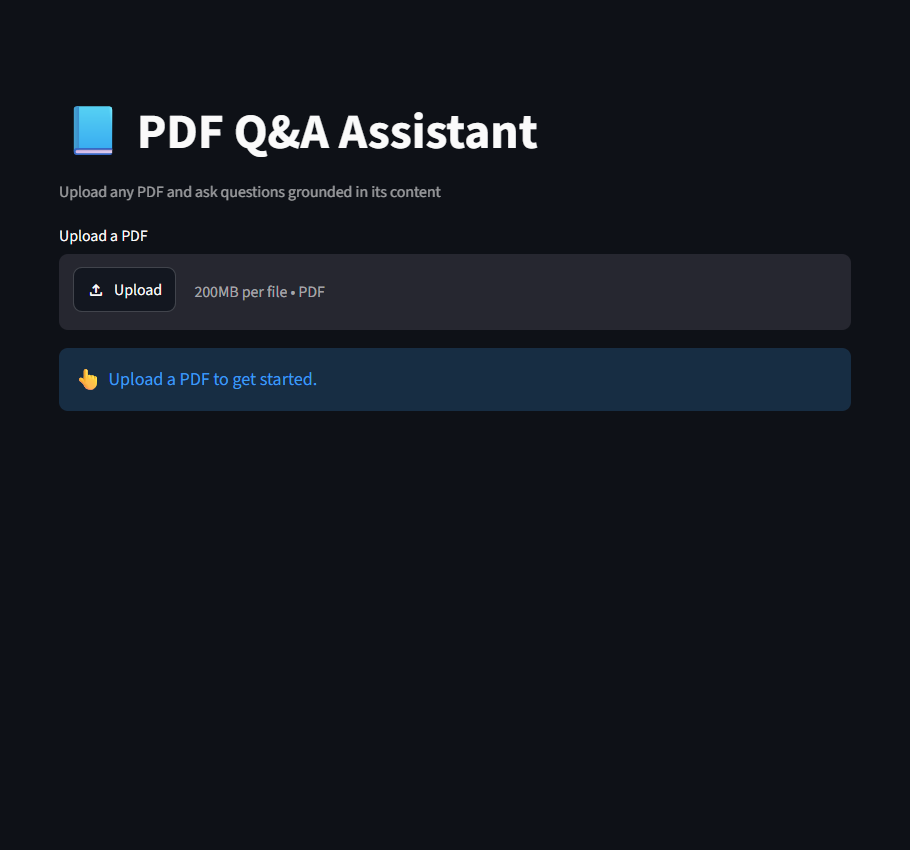
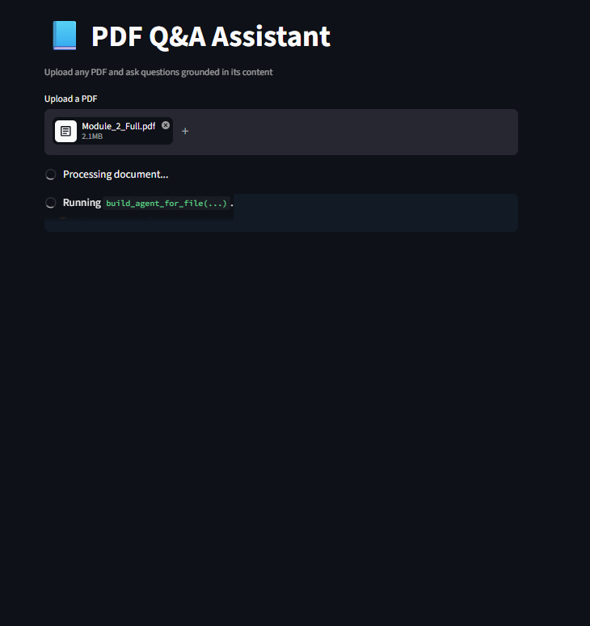
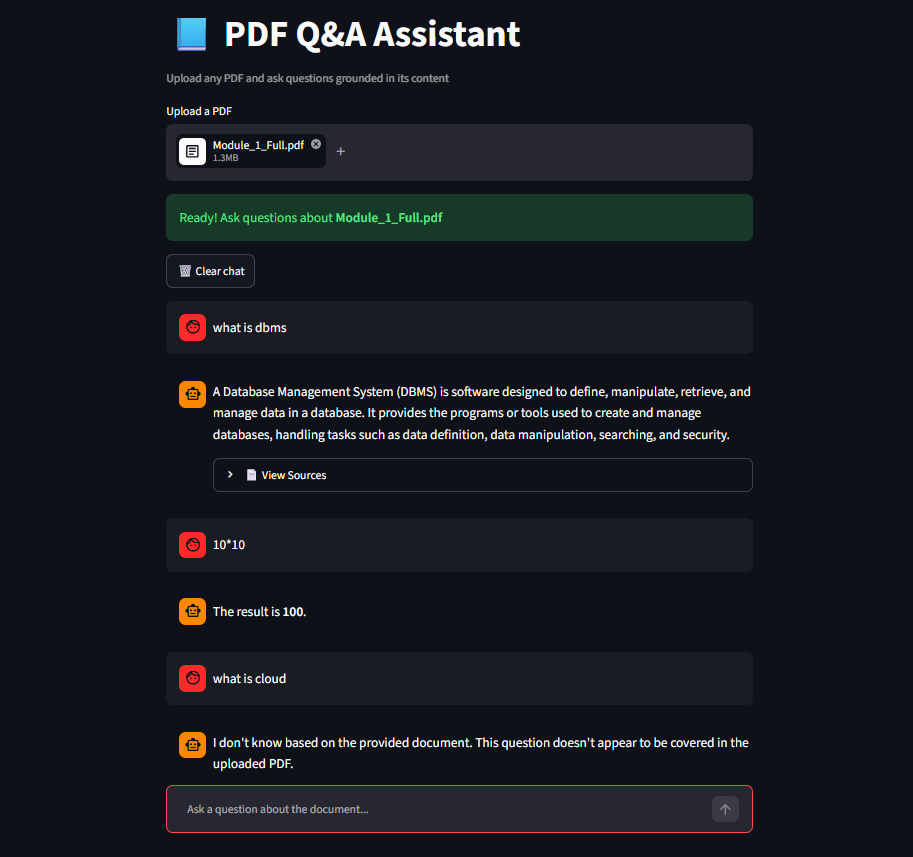
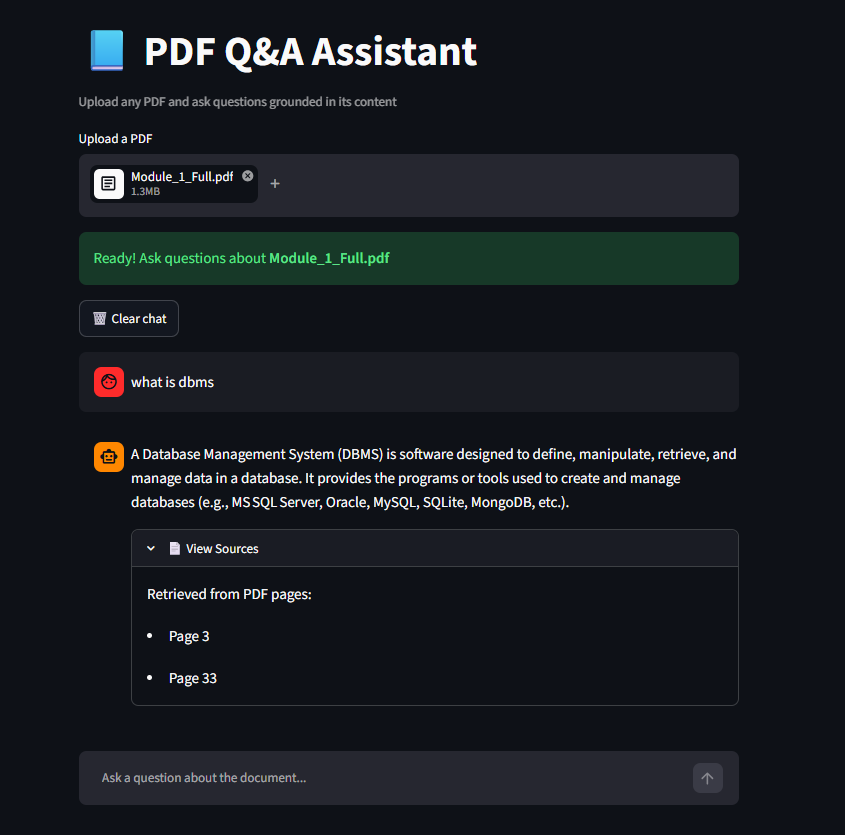
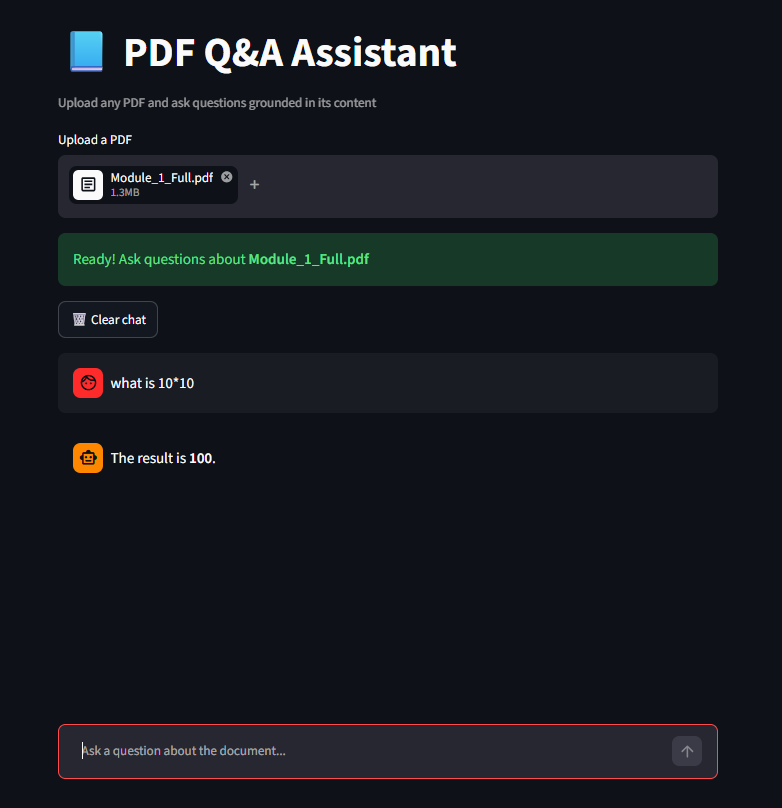
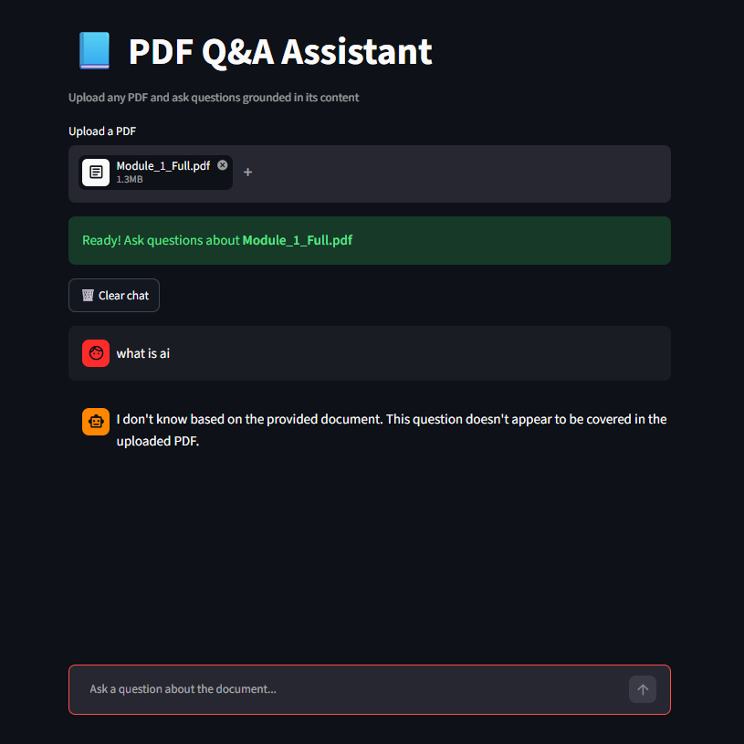

# 📘 PDF Q&A Assistant — RAG + Agent Pipeline

An AI-powered document question-answering application that allows users to upload PDF files and ask questions based on their contents. Built using Python, LangChain, LangGraph, HuggingFace, ChromaDB, Groq and Streamlit.

The application combines Retrieval-Augmented Generation (RAG) with an AI agent to retrieve relevant document information, perform mathematical calculations and generate context-aware responses.

## 🎯 Problem Statement

General-purpose Large Language Models (LLMs) do not inherently have access to users' private documents. Passing entire documents directly into prompts is also inefficient, particularly when working with lengthy PDFs, because it increases token consumption and can exceed context-window limitations.

This project addresses these challenges using Retrieval-Augmented Generation (RAG).

Instead of passing the entire document to the LLM, the application extracts and splits document text into smaller chunks, converts them into vector embeddings, and retrieves only the most relevant information when a question is asked.

A relevance-checking mechanism evaluates retrieved content before allowing the LLM to generate an answer. Additionally, a separate calculation-processing path allows mathematical questions to be handled without requiring document retrieval.

## ✨ Features

- **PDF Upload:** Upload PDF documents directly through the Streamlit interface.
- **Text Extraction:** Extract document text using PyPDFLoader.
- **Intelligent Chunking:** Split extracted text into smaller, overlapping chunks for efficient retrieval.
- **Local Embeddings:** Generate vector embeddings using HuggingFace's `all-MiniLM-L6-v2`.
- **Vector Storage:** Store and retrieve embeddings using ChromaDB.
- **Persistent Storage:** Maintain separate vector stores for different PDF documents.
- **Content-Based Caching:** Use MD5 hashing to identify document content and reuse existing embeddings when the same content is uploaded again.
- **Semantic Search:** Retrieve the top three relevant document chunks using similarity search.
- **Relevance Gate:** Evaluate retrieval distance scores before invoking the LLM for document questions.
- **Calculation Routing:** Identify mathematical requests and route them to the calculator without passing through the document relevance gate.
- **Safe Calculator:** Evaluate supported mathematical expressions using a restricted Python AST-based evaluator instead of unrestricted `eval()`.
- **Agent-Based Processing:** Use a LangChain agent with document-search and calculator tools.
- **Context-Grounded Responses:** Generate document answers using retrieved context.
- **Source Attribution:** Extract page metadata from retrieved chunks and display source page numbers below document-based answers.
- **Persistent Chat History:** Retain previous questions, answers and their associated source page numbers across Streamlit reruns.
- **Out-of-Scope Handling:** Return an appropriate response when retrieved document content does not meet the relevance threshold.

## 🖥️ Application Screenshots

### 1. Main Application Interface

<!-- Add screenshot of the main Streamlit application here -->



### 2. PDF Upload

<!-- Add screenshot showing PDF upload functionality here -->



### 3. Document Question Answering

<!-- Add screenshot showing a question and its generated answer -->



### 4. Source Page Citations

<!-- Add screenshot showing the expanded View Sources section -->



### 5. Mathematical Calculations

<!-- Add screenshot showing calculator functionality -->



### 6. Out-of-Scope Question Handling

<!-- Add screenshot showing an unrelated question being rejected -->



## 🏗️ System Architecture

The application follows a document ingestion pipeline and a query-processing pipeline.

### 1. Document Ingestion Pipeline

```text
             PDF Upload
                  |
                  v
             PyPDFLoader
            (Text Extraction)
                  |
                  v
     RecursiveCharacterTextSplitter
       (500 Characters, 50 Overlap)
                  |
                  v
        HuggingFace Embeddings
         (all-MiniLM-L6-v2)
                  |
                  v
           Chroma Vector Store
                  |
                  v
        Persistent Local Storage
          (MD5 Content Hash)
```

### 2. Query Processing Pipeline

```text
              User Question
                    |
                    v
              Query Routing
                    |
              +-----+------+
              |            |
         Calculation     Document
           Request       Question
              |            |
              v            v
         Safe AST      Similarity Search
         Calculator      (Top 3 Chunks)
              |            |
              v            v
         Calculation   Relevance Gate
           Result       (Threshold 1.15)
                           |
                     +-----+------+
                     |            |
                  Relevant    Irrelevant
                     |            |
                     v            v
                LangChain     Out-of-Scope
                  Agent        Response
                     |
               +-----+------+
               |            |
               v            v
          Search Tool   Calculator
               |
               v
            Groq LLM
               |
               v
         Generated Answer
               |
               v
        Source Page Display
```

The initial retrieval and relevance checking are performed in Python before the agent is invoked. Calculation requests follow a separate path and bypass document retrieval.

## ⚙️ Key Technical Decisions

### 1. Local Embeddings and Cloud-Based LLM Inference

The application uses HuggingFace's `all-MiniLM-L6-v2` model to generate embeddings locally.

Groq is used for LLM inference through the `openai/gpt-oss-120b` model.

This approach separates embedding generation from language generation, allowing document embeddings to be generated locally without requiring a separate cloud embedding API.

### 2. ChromaDB for Vector Storage

ChromaDB was selected because it provides lightweight local vector storage without requiring a separately managed database server.

It supports persistent storage, allowing document embeddings to be reused across application sessions.

### 3. Content-Based Caching Using MD5

Instead of identifying documents using filenames, the application generates an MD5 hash based on file content.

This solves two problems:

- Uploading the same document with a different filename does not require generating embeddings again.
- Uploading a different document with the same filename creates a separate vector store.

This reduces unnecessary embedding computation and prevents filename-based cache collisions.

### 4. Relevance Gate Before LLM Invocation

An early implementation relied on system-prompt instructions asking the agent to retrieve document information before answering.

However, testing revealed that the agent could sometimes answer questions using its general training knowledge without retrieving relevant document content.

To address this, retrieval and relevance checking were moved outside the agent's control.

The application now:

1. Retrieves the top three matching chunks.
2. Evaluates their similarity distance scores.
3. Checks the best matching distance against a configured threshold of 1.15.
4. Allows generation only when the relevance condition passes.
5. Returns an out-of-scope response when the condition fails.

This makes document retrieval a prerequisite for generation and reduces unsupported answers.

The threshold was selected empirically by observing scores across relevant and irrelevant queries rather than choosing an arbitrary value.

### 5. Calculation Intent Routing

Initially, all user questions passed through the document relevance gate.

This created a problem: mathematical questions such as `Calculate 9*10` were rejected because they did not semantically match the uploaded PDF.

To solve this, a calculation-intent detection mechanism was introduced before document retrieval.

The application identifies calculation requests using:

- Mathematical keywords such as `calculate`, `compute` and `solve`, when accompanied by a number.
- Basic arithmetic expressions containing numeric operands and mathematical operators.

Detected calculation requests bypass document retrieval and are sent directly to the LangChain agent with instructions to use the calculator tool.

Document-related questions continue through the normal RAG pipeline.

### 6. Safe Mathematical Evaluation Using Python AST

The initial calculator implementation used Python's built-in `eval()` function.

However, `eval()` can execute arbitrary Python expressions, which creates unnecessary security risks when exposed through an LLM-accessible tool.

The implementation was improved using Python's Abstract Syntax Tree (AST) module.

The evaluator parses mathematical expressions and explicitly allows supported operations, including:

- Addition
- Subtraction
- Multiplication
- Division
- Floor division
- Modulo
- Exponentiation
- Unary positive and negative operations

Unsupported expressions are rejected rather than executed.

Additional restrictions limit exponent sizes and unusually large results.

This follows the principle of least privilege by restricting the calculator to its intended mathematical operations.

### 7. Persistent Source Page Citations

During PDF extraction, page metadata is preserved in the document chunks.

When a question is asked:

1. The application retrieves the top three relevant chunks.
2. Page metadata is extracted from the retrieved documents.
3. Retrieved content is passed to the LLM as context, including its page information.
4. Unique source page numbers are collected.
5. Source pages are displayed in an expandable Streamlit section below the generated answer.

To preserve citations across Streamlit reruns, source page numbers are stored alongside the corresponding assistant message in `st.session_state.messages`.

This ensures that previous answers retain their source information even after subsequent questions are submitted.

The displayed pages represent retrieved source chunks and are not an independent verification that every page supports the entire generated answer.

### 8. Agent-Based Architecture

The application uses LangChain's `create_agent` to support tool-based processing.

The agent has access to two tools:

- **search_document:** Retrieves relevant information from the uploaded PDF.
- **calculator:** Evaluates supported mathematical expressions using the restricted AST-based evaluator.

Initial retrieval and relevance checking are handled separately in Python for document questions, while the agent handles subsequent tool-assisted processing and response generation.

## 🐛 Challenges Faced and Solutions

| Challenge | Solution |
|---|---|
| Repeated embedding generation on application reruns | Implemented persistent Chroma storage and content-hash-based caching |
| Same filename causing potential cache collisions | Used MD5 content hashing instead of filename-based identification |
| Agent answering without retrieving document information | Moved retrieval and relevance checking outside the agent |
| Unrelated questions receiving confident answers | Implemented a relevance gate before LLM invocation |
| Mathematical questions being rejected by the relevance gate | Introduced calculation-intent routing |
| Unsafe calculator implementation using `eval()` | Replaced unrestricted evaluation with a restricted AST-based evaluator |
| Source citations disappearing after subsequent questions | Stored source page numbers alongside assistant messages in Streamlit session state |
| Deprecated Groq model | Migrated to `openai/gpt-oss-120b` |
| Deprecated `create_react_agent` API | Migrated to LangChain's `create_agent` |
| Windows Smart App Control blocking a compiled dependency | Investigated dependency imports and resolved the issue through package reinstallation |
| Citation marker artifacts appearing in responses | Implemented regex-based cleanup before rendering answers |

## 🧪 Testing and Validation

The application was tested against different document, calculation and query scenarios.

| Test Scenario | Expected Behaviour |
|---|---|
| Relevant question about an uploaded PDF | Retrieve matching chunks and generate an answer |
| Unrelated question | Reject through the relevance gate |
| Same PDF uploaded again | Reuse the existing vector store |
| Different PDF with the same filename | Create a separate vector store |
| Long PDF document | Split into manageable chunks |
| Application rerun | Load previously persisted embeddings |
| Basic mathematical expression | Route to calculator and return the result |
| Mathematical question unrelated to PDF | Bypass document relevance gate |
| Unsupported calculator expression | Reject the expression |
| Multiple consecutive document questions | Preserve previous answers and their source pages |
| Calculation after a document question | Retain previous document citations without showing irrelevant sources |

## 🛠️ Technology Stack

| Category | Technology |
|---|---|
| Programming Language | Python |
| Frontend / UI | Streamlit |
| LLM | Groq – `openai/gpt-oss-120b` |
| Embedding Model | HuggingFace – `all-MiniLM-L6-v2` |
| Vector Database | ChromaDB |
| LLM Orchestration | LangChain |
| Agent Framework | LangChain `create_agent` / LangGraph |
| PDF Processing | PyPDFLoader |
| Text Chunking | RecursiveCharacterTextSplitter |
| Embedding Library | Sentence Transformers |
| Safe Mathematical Evaluation | Python AST and Operator |
| Environment Management | uv |
| Version Control | Git and GitHub |

## 🚀 Installation and Setup

### Prerequisites

- Python 3.13 or higher
- uv package manager
- Groq API key

### 1. Clone the Repository

```bash
git clone https://github.com/nitingarg20/pdf-qa-rag-assistant.git

cd pdf-qa-rag-assistant
```

### 2. Create a Virtual Environment

```bash
uv venv
```

Activate the environment on Windows PowerShell:

```powershell
.venv\Scripts\Activate.ps1
```

### 3. Install Dependencies

```bash
uv sync
```

### 4. Configure Environment Variables

Create a `.env` file in the project root:

```env
GROQ_API_KEY=your_groq_api_key
```

Get your API key from:

https://console.groq.com/

### 5. Run the Application

```bash
uv run streamlit run app.py
```

The application will open in your browser.

## ⚠️ Known Limitations

- **Threshold Generalization:** The relevance threshold of 1.15 was tuned against a limited document and query distribution. Different embedding distributions may require recalibration.
- **Scanned PDFs:** The current PDF extraction pipeline is designed for text-based PDFs. Scanned documents require OCR preprocessing.
- **Calculation Intent Detection:** The current routing mechanism handles explicit calculation keywords and basic numeric arithmetic expressions. More complex natural-language mathematical requests may require improved intent detection.
- **LLM Reliability:** Although relevance gating reduces unsupported answers, the LLM can still produce inaccurate responses when relevant context is retrieved.
- **Source Attribution:** Displayed source pages represent retrieved chunks and may not independently establish every statement in the generated answer.
- **Local Storage:** ChromaDB persistence is designed for a local application rather than a multi-user production deployment.
- **Conversation Persistence:** Chat history and source citations are maintained in Streamlit session state and are not stored permanently across separate browser sessions.

## 🔮 Future Improvements

- Integrate OCR for scanned PDF support.
- Migrate the application backend from Streamlit to FastAPI.
- Introduce a dedicated frontend for a more scalable user experience.
- Improve retrieval using hybrid search and reranking.
- Evaluate relevance thresholds across a larger collection of documents.
- Improve calculation intent detection for more complex mathematical questions.
- Improve source attribution and display more detailed document references.
- Introduce user authentication and document-level access control.
- Explore scalable vector database deployment for multi-user environments.
- Implement persistent conversation storage.

## 👨‍💻 Author

**Nitin Garg**

Electronics and Computer Engineering  
Thapar Institute of Engineering and Technology

GitHub: [nitingarg20](https://github.com/nitingarg20)

---

⭐ If you find this project interesting, feel free to explore the repository and share your feedback.

**Repository:** [PDF Q&A Assistant — RAG + Agent Pipeline](https://github.com/nitingarg20/pdf-qa-rag-assistant)
